# Docker Image Management

## Introduction

Docker image management involves creating, managing, and distributing Docker images. Docker images are the building blocks of Docker containers, which are lightweight and portable virtualized environments that can run anywhere. It uses a layered architecture to build and manage Docker images. Each layer in the Docker image represents a specific set of changes or additions to the previous layer.

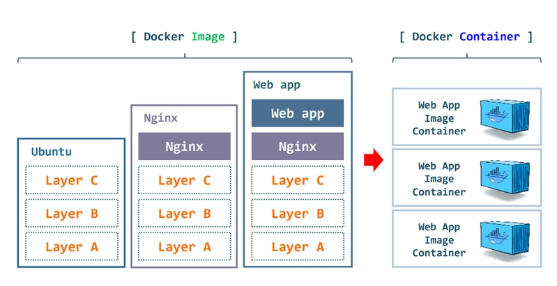

## Docker Image Archive
Docker provides two different methods to save and load Docker images:

* docker save/docker load

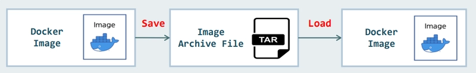

**docker save** and **docker load** are used to save and load entire Docker images along with all of their layers and metadata.

* docker export/docker import

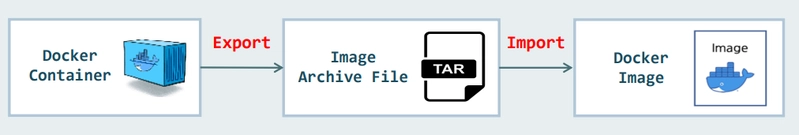

**docker export** and **docker import** are used to export and import a container as a tar file. Docker export and docker import do not include metadata or information about the image's layers.

## Short hands on
### Save/Load
Creating an empty directory

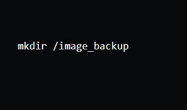

Checking current images detail

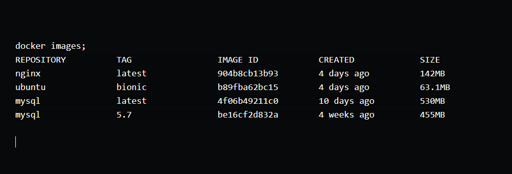

To save a backup for a specific image

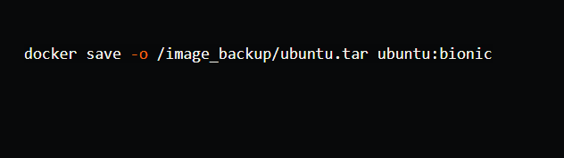

So now if we delete the image

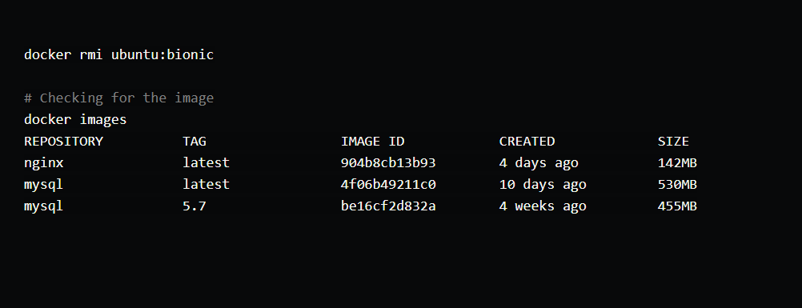

We can load the **ubuntu:bionic** image from the backup directory

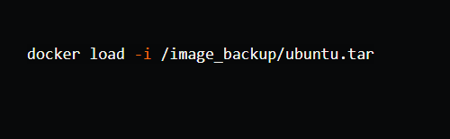

Checking the results

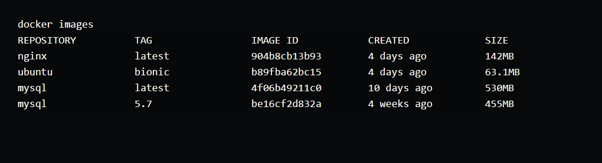

### Export/Import
Creating a new container using the ubuntu image

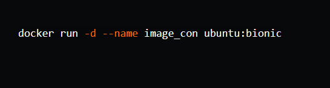

Exporting this container

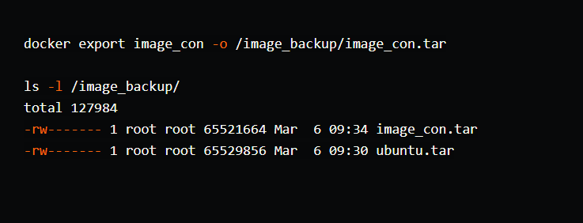

Now we can import this image with a different tag

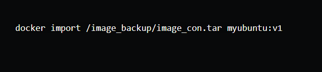

Checking the results

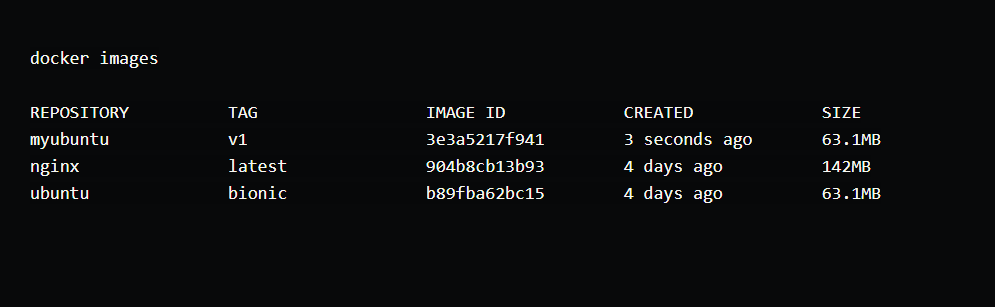

## Docker Image Commit & Build

**docker commit** and **docker build** are both Docker commands used to create Docker images

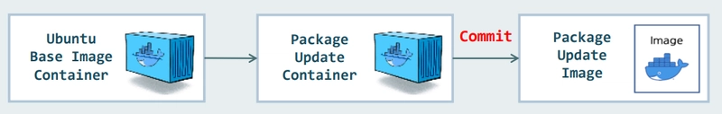

**docker commit** command is used to create a new Docker image from an existing container. This command is useful when you have made changes to a running container, and you want to save those changes as a new image.

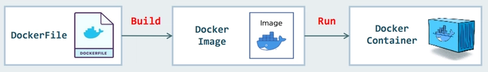

**docker build** command is used to create a new Docker image from a Dockerfile. A Dockerfile is a script that contains instructions on how to build a Docker image

Some of the commonly used Dockerfile instructions:

* **FROM:** This instruction is used to specify the base image that the new image will be built on top of
* **LABEL:** This instruction is used to add metadata to the image
* **RUN:** This instruction is used to execute commands within the container
* **ADD:** This instruction is used to copy files from the host system into the container
* **WORKDIR:** This instruction is used to set the working directory for any subsequent commands in the Dockerfile
* **EXPOSE:** This instruction is used to specify which port(s) the container will listen on at runtime
* **CMD:** This instruction is used to specify the default command to be executed when the container starts
* **ENTRYPOINT:** This instruction is used to specify the command that will be executed when the container starts, and it cannot be overridden when the container is run

## Short hands on
### Docker Commit
To check how many layers are there in the ubuntu image

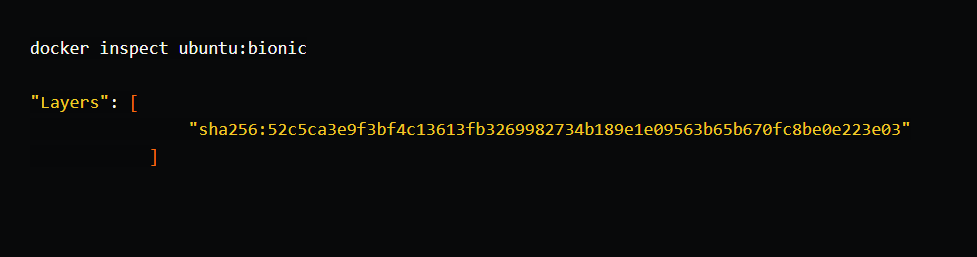

Creating the container using the **-it** option

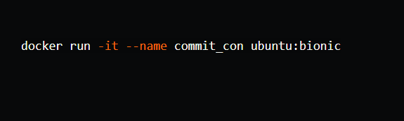

From inside the container,

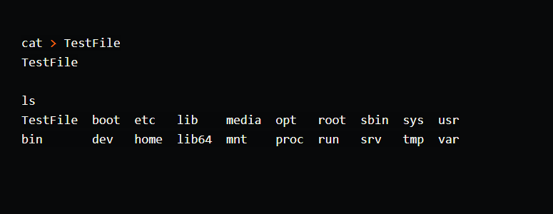

Now from the host machine

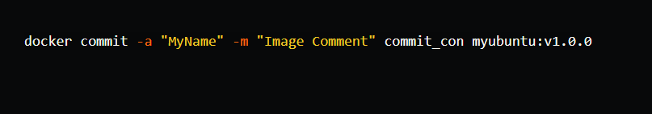

We can confirm this commit using

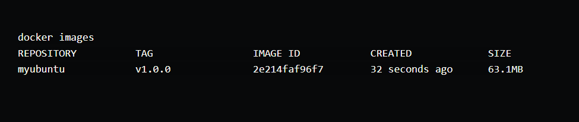

Inspecting our v1.0.0 ubuntu image

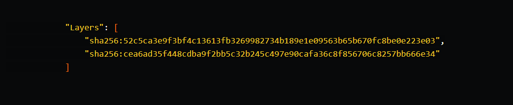

We can see that a new image was created with an extra layer when we committed the changes for our ubuntu container

### Docker Build
Creating an empty directory for our dockerfile

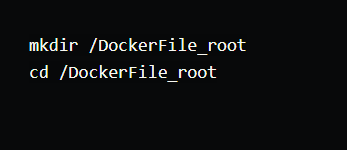

Creating an empty dockerfile

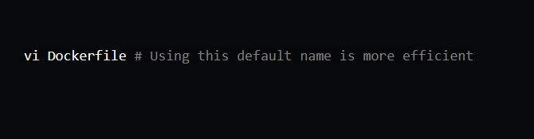

Adding the following inside this file

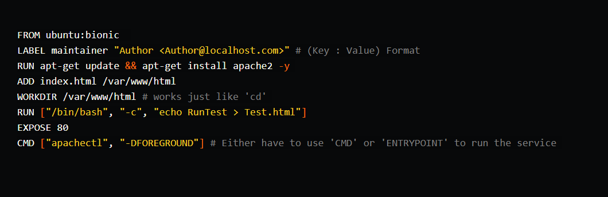

Creating an **index.html**

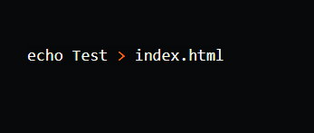

Our working directory is currently **/DockerFile_root** which is also known as **Build Context Directory**

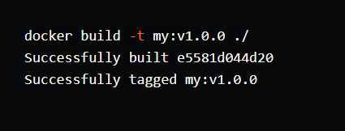

This is where the docker build should happen

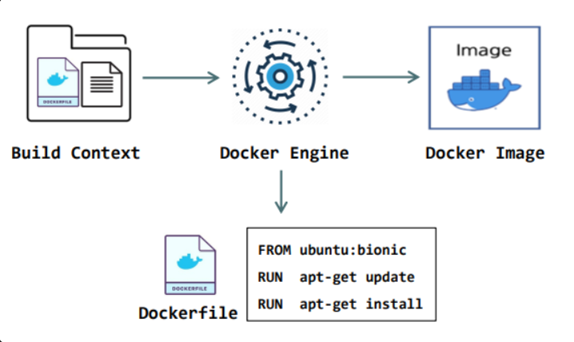

Checking our new image

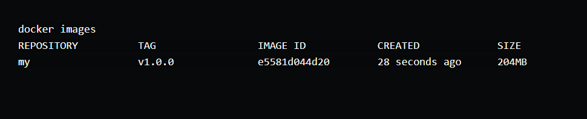

Creating and starting the container

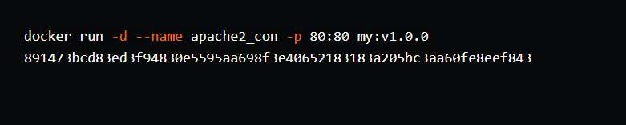

If we check inside the container

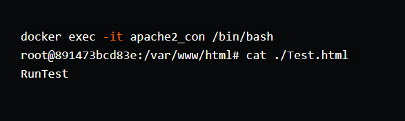

Returning to the host system and checking port 80

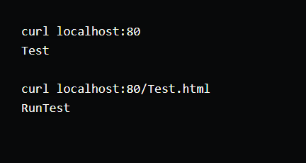

### Docker Build Cache & Image Sizes
Finally, I want to discuss regarding Docker build sizes and how to manage them

Creating a new Dockerfile

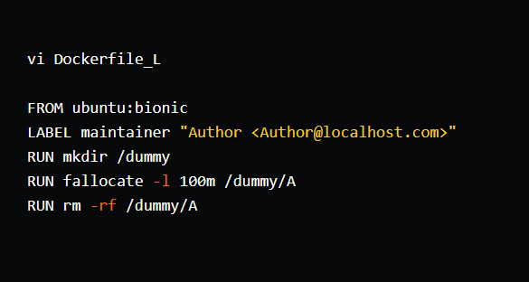

To build this image

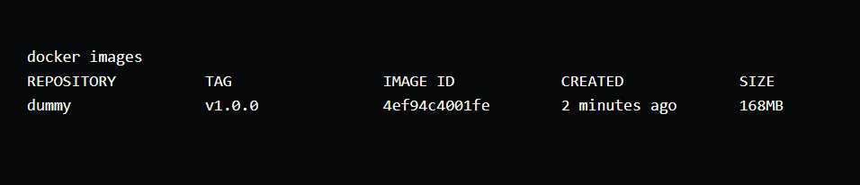

The **-f** option in the docker build command specifies the Dockerfile name to use during the build process, when the Dockerfile is not named "Dockerfile"

This will build the image as follows

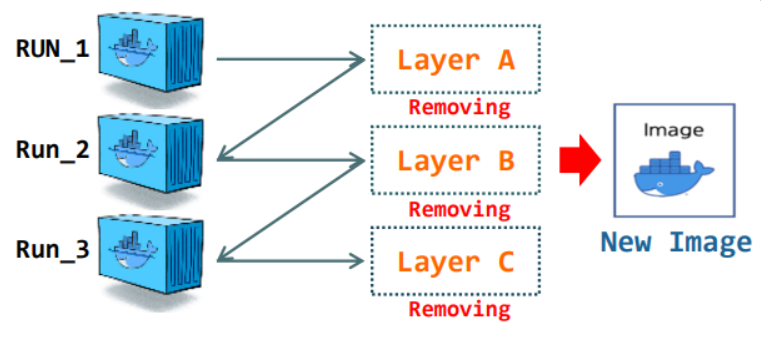

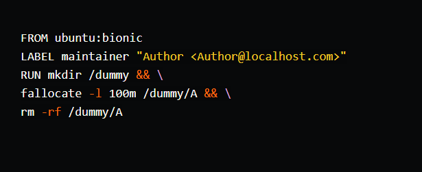

As we can see that it is 168MBs big. We know that ubuntu:bionic is only about 63MBs. In the Dockerfile we just created dummy directory and deleted a file inside the directory that cost us over 100MBs

To decrease the size we can try to edit our Dockerfile

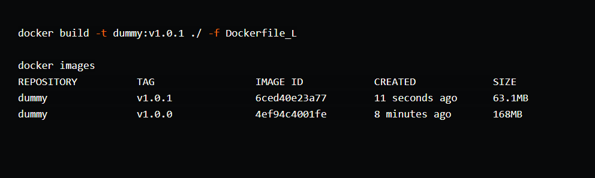

Now if we check the image size after building this new image

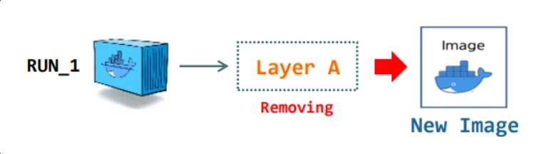

