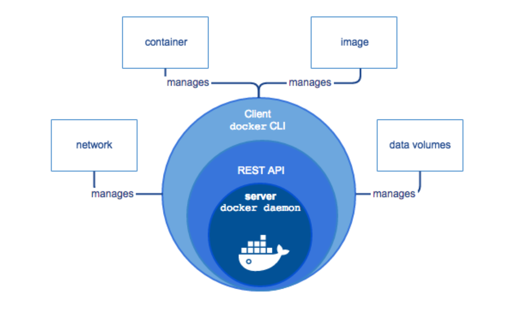
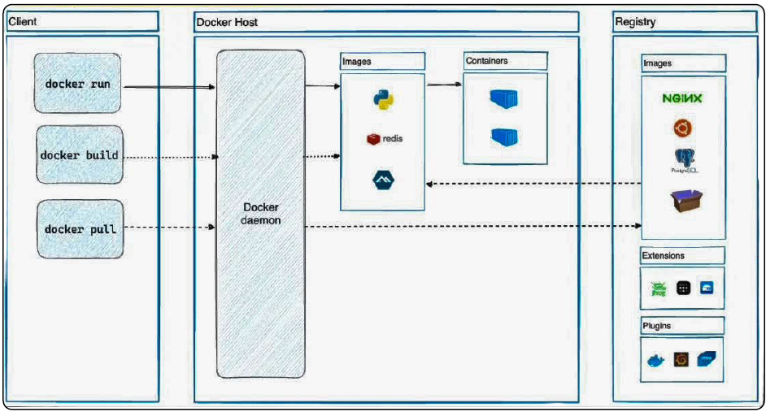
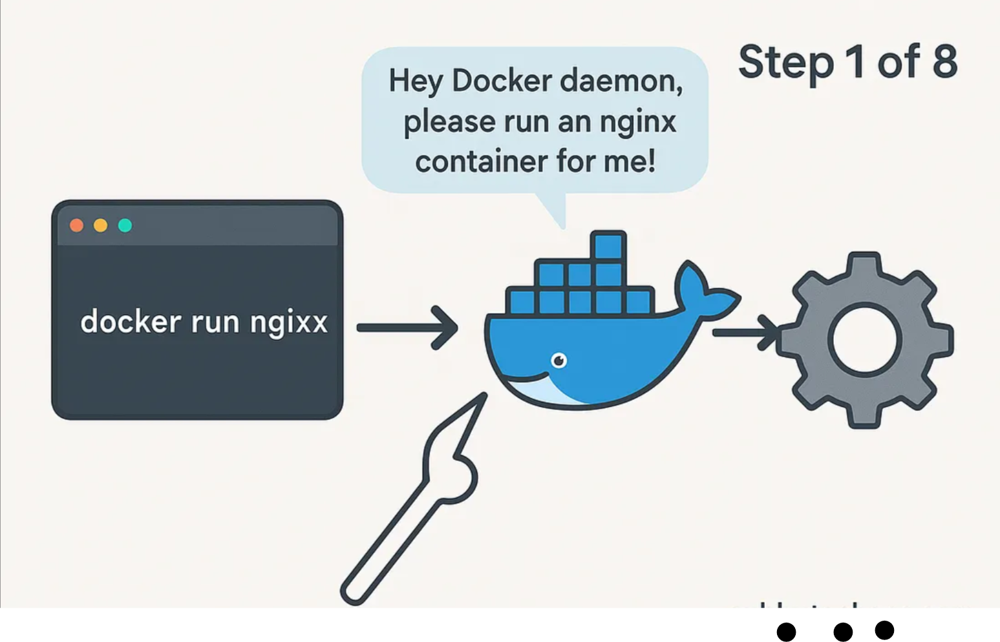
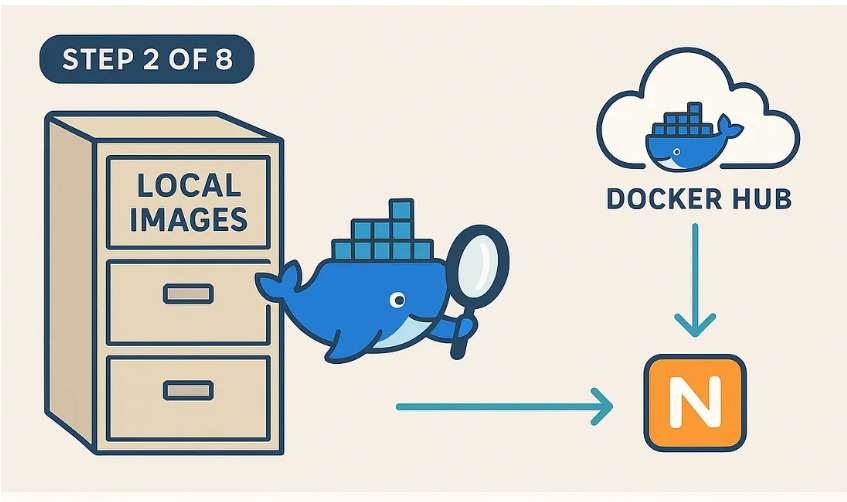
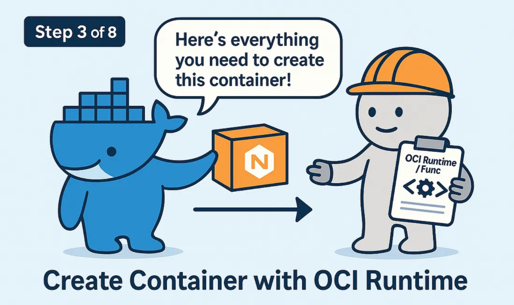
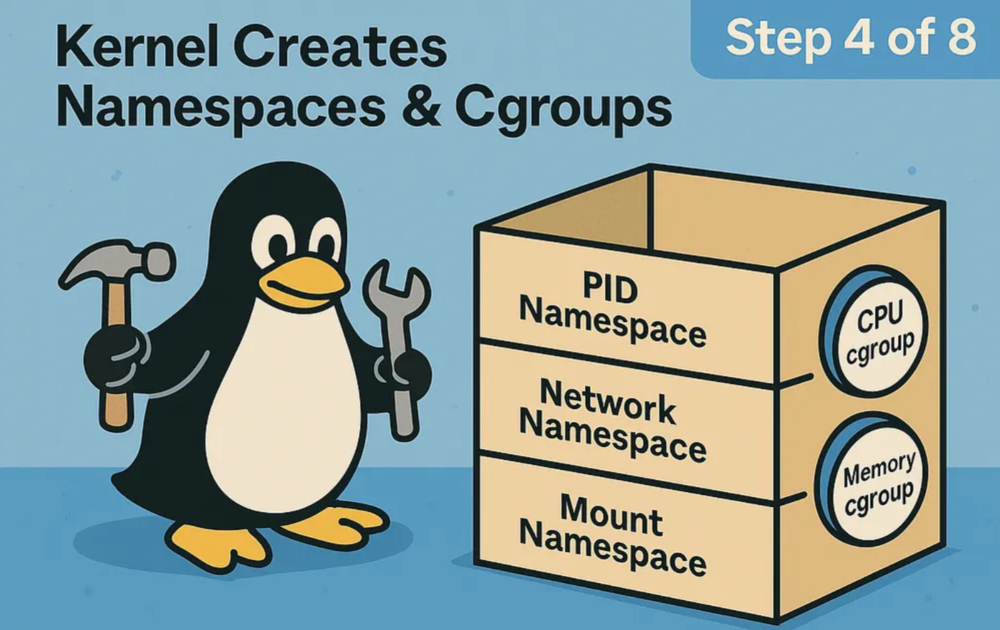
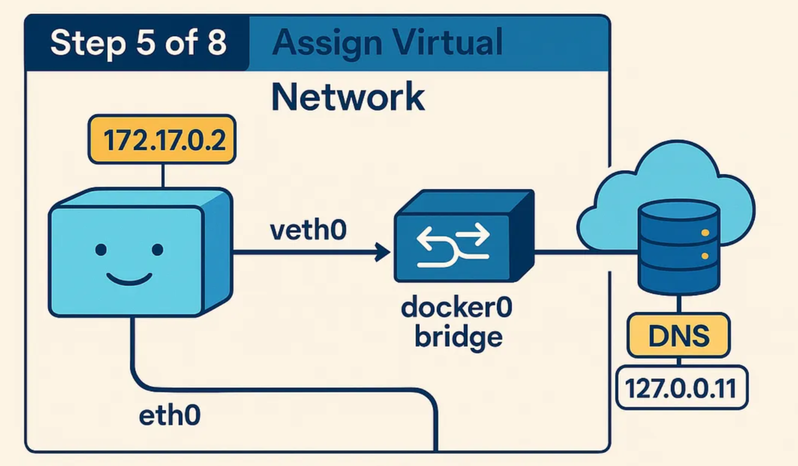
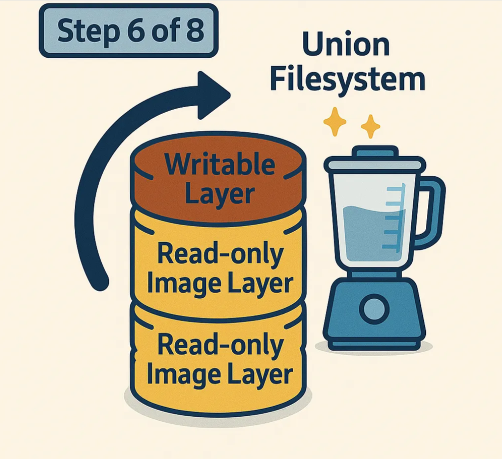
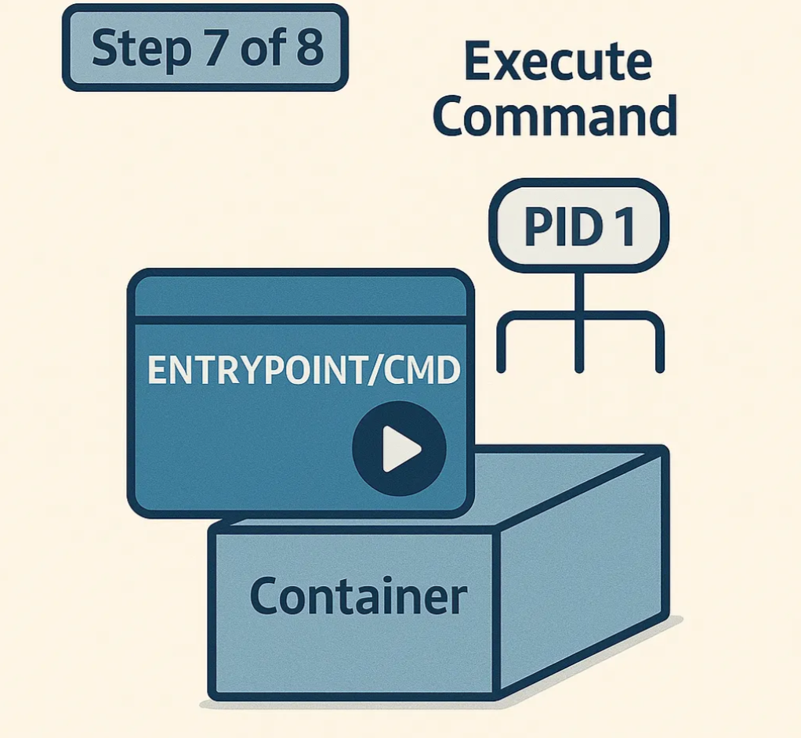
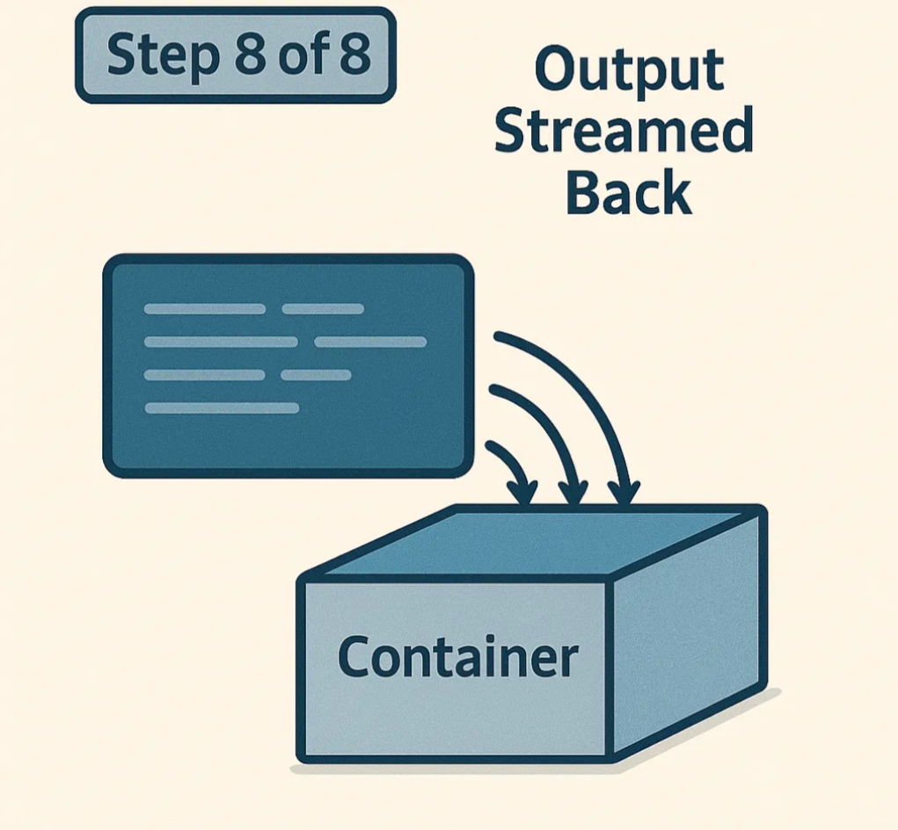

## Docker Architecture: Why Is It Important?

Docker is a powerful containerization platform widely used in DevOps for streamlining the development, deployment, and management of applications. It enables developers to package applications and their dependencies into lightweight, portable containers, ensuring consistent performance across various environments. Though Docker isn’t a mandatory component of DevOps, it significantly improves efficiency, especially when paired with Kubernetes for managing and orchestrating containers. 

# Traditional Virtualization vs. Docker

## ~*~ Virtual Machines (VMs) ~*~

* A virtual machine emulates physical hardware and runs an entire operating system (OS) along with applications. While VMs offer isolation and flexibility, they require considerable system resources, as each VM includes a full OS, making them resource-heavy and slower to start.

## ~*~ Docker Containers ~*~

* Docker containers offer a lightweight alternative by virtualizing at the operating system level. Instead of including an entire OS, containers share the host OS kernel, significantly reducing overhead. Each container packages an application along with its dependencies, ensuring it runs consistently regardless of the environment.

## Key Differences:

* VMs abstract the **hardware**, while Docker containers **abstract the OS**.
* Containers are faster to start and require fewer resources compared to VMs.

## How Docker Works

The Docker platform revolves around **the Docker Engine, which manages the lifecycle of containers**. Its workflow involves:

### 1. Docker Daemon:

* A background process that **builds, runs, and manages Docker objects such as containers, images, networks, and volumes**.
* Processes API requests and performs container-related tasks.

### 2. Docker REST API:

* Enables communication between **applications and the Docker Daemon**.
* Facilitates interactions through **HTTP clients**.
  
### 3. Docker CLI:

* A command-line tool that allows users to interact with the Docker Daemon.
* Simplifies the management of Docker containers and related objects.
  
The Docker client communicates with the Docker Daemon using the REST API, sending commands that the Daemon executes. This interaction can occur on the same system or remotely over a network.

## Docker Architecture

**Docker’s architecture follows a client-server model** and includes the following components:

### 1. Docker Client

The client is the user interface for executing Docker commands. It sends these commands to the Docker Daemon, which carries out the tasks. The Docker client can connect to multiple daemons simultaneously, enabling centralized control over distributed environments.

### 2. Docker Host

The Docker host includes all the components needed to run containers, such as the Docker Daemon, images, networks, containers, and storage. **It serves as the execution environment for containerized applications**.

### 3. Docker Objects

#### 3.1 Images:

* Serve as the blueprint for creating containers.
* Contain application code, dependencies, and metadata, enabling consistent deployment across environments.

#### 3.2 Containers:

* Lightweight, standalone environments where applications run.
* Defined by images and additional configurations such as storage options and network settings.

#### 3.3 Networks:

* Provide communication pathways between containers.
* Include drivers like bridge (default), host, overlay, none, and macvlan for various networking scenarios.

#### 3.4 Storage:

* Supports multiple methods for persistent data management, such as volumes, volume containers, directory mounts, and storage plugins.

#### 4. Docker Registry

* Docker registries store and distribute images. Public options, such as Docker Hub, allow developers to share images, while private registries offer secure, organization-specific storage. Commands like docker pull, docker push, and docker run manage image workflows.

# Core Components of Docker Architecture

### 1. Docker Client

* The Docker Client is what users interact with directly. When you type a command like docker run or docker build into your terminal, you're using the Docker Client. It doesn't do the actual work itself — instead, it sends these commands to the Docker Daemon, which carries them out. The client can communicate with a daemon running on the same machine or, using Docker's networking features, with a daemon running on a remote host.

### 2. Docker Daemon (dockerd)

* The Docker Daemon is the core engine of the entire system. It runs continuously in the background and listens for API requests coming from the Docker Client. The daemon is responsible for building images, running containers, managing storage volumes, and handling networking between containers. It also manages Docker objects like images, containers, networks, and volumes. Essentially, whenever anything happens in Docker, the daemon is the component actually making it happen.

### 3. Docker Images

* A Docker image is a read-only template that contains the instructions for creating a container. Images are built in layers, with each layer representing a change or addition — like installing a package or copying application code. These layers are cached, which means rebuilding an image after a small change is usually fast, since Docker only needs to rebuild the layers that actually changed. Images are typically built from a Dockerfile, a plain text file containing step-by-step build instructions.

### 4. Docker Containers

* A container is a running instance of an image. It's the actual isolated environment where your application executes. Containers include everything defined in the image, plus a writable layer on top, which is where any runtime changes are stored. Multiple containers can be created from the same image, and each one runs independently, with its own filesystem, networking, and process space, isolated from the others.

### 5. Docker Registry
 
* A registry is where Docker images are stored and distributed. Docker Hub is the most widely used public registry, but organizations often run private registries internally for proprietary images. When you run docker pull, you're retrieving an image from a registry. When you run docker push, you're uploading one. This distribution layer is what makes it possible to build an image once and deploy it consistently across many different environments.

### 6. Docker Objects: Volumes and Networks

* Beyond images and containers, Docker manages a few other important objects:

 #### 6.1 Volumes 
   * persistent storage that exists independently of a container's lifecycle, used for data that needs to survive even after a container is removed
 #### 6.2 Networks 
   * virtual networks that let containers communicate with each other and with the outside world, supporting different drivers depending on whether containers need to talk to each other on the same host or across multiple hosts

## Docker Workflow: How It All Works Together

Understanding the components is helpful, but seeing how they interact during a typical workflow makes the architecture click into place. Here's what generally happens when you run a container:

#### Step 1: Docker Client Sends Command

When you type a command like docker run nginx in your terminal, you're talking to the Docker client. This client:

      * Takes your command
      * Formats it properly
      * Sends it to the Docker daemon (the engine that does the actual work)

Think of it like ordering at a restaurant — you (the user) tell the waiter (Docker client) what you want, and they take your order to the kitchen (Docker daemon).

#### Step 2: Docker Daemon Checks Local Image

Once the Docker daemon receives your request, it first checks if it already has the image (in our example, nginx) on your computer.

If it doesn’t find the image:

  * It connects to Docker Hub (or another registry you’ve configured)
  * Downloads the image
  * Stores it locally for future use

This is like the kitchen checking if they have all the ingredients. If not, they send someone to the store to get what’s needed.

#### Step 3: Create Container with OCI Runtime

The Docker daemon doesn’t actually create the container itself. Instead, it hands off this job to an OCI (Open Container Initiative) runtime, typically **runc**. This standardized container runtime:

  * Takes the image
  * Creates container specifications
  * Prepares everything for the Linux kernel

#### Step 4: Kernel Creates Namespaces & Cgroups

Now the Linux kernel steps in and creates two important things:

 **Namespaces**: These provide isolation by making the container think it has its own copy of resources (network interfaces, process IDs, etc.)
 **Cgroups (Control Groups)**: These limit how many resources the container can use (CPU, memory, etc.)

Namespaces are like giving the container its own private room, while cgroups are like setting rules for how much of the house’s electricity and water it can use.

#### Step 5: Assign Virtual Network

Docker sets up networking so your container can communicate:

  * Creates a virtual network interface (veth pair)
  * Connects one end to the container and one end to the Docker bridge
  * Assigns the container an IP address
  * Sets up DNS resolution so the container can find other services by name

This is similar to setting up a new phone with its own phone number and contact list.

#### Step 6: Add Writable Layer

Docker images are made up of read-only layers, but containers need a place to write data. Docker:

  * Mounts all the read-only image layers
  * Adds a new writable layer on top where all changes will be stored
  * Uses a union filesystem to combine these layers so they appear as one filesystem

Think of this like giving someone a reference book (read-only) and a notebook (writable) — they can read from the book but write their notes in the notebook.

#### Step 7: Execute Command

With everything set up, Docker now executes the container’s default command (usually defined in the image’s Dockerfile as CMD or ENTRYPOINT). This launches the main process that the container will run.

#### Step 8: Output Streamed Back

Finally, any output from the container (logs, error messages, etc.) is captured by Docker and streamed back to your terminal. This allows you to see what’s happening inside the container even though it’s running in isolation.

**This is the power of Docker’s container creation flow — complex operations are abstracted away, letting you focus on your application rather than infrastructure details.**

## Easy way to remember:
## *Client → Daemon → Image → Runtime → Kernel → Network → Filesystem → Execute → Output*
