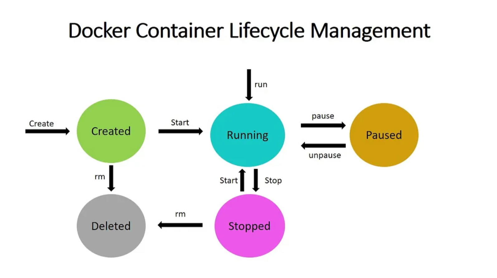

### Docker Container
A Docker Container is a lightweight, runnable instance of a Docker Image. It packages the application code together with all its dependencies and runs it in an isolated environment. Containers allow applications to run quickly and consistently across different environments — whether on a developer’s laptop, test servers, or production.

  * A container is created when a Docker Image is executed.
  * It runs as an isolated process on the host machine but shares the host’s operating system kernel.
  * Multiple containers can run on the same system without interfering with each other.

#### Relation to Images:

**Docker Image** --> Blueprint (static, read only).
**Docker Container** --> Live instance of that blueprint (dynamic, executable)

#### Relation to Containers:

**Docker Image** --> Blueprint (static, read only).
**Docker Container** -->  Running instance of that image (dynamic, executable)

### Docker Container Lifecycle Management

The Docker Container Lifecycle describes the various stages that occur when we create a Docker container. Among the states are:

**Created:** A container that has been created but not started
**Running:** A container running with all its processes
**Paused:** A container whose processes have been paused
**Stopped:** A container whose processes have been stopped
**Deleted:** A container in a dead state

Docker Container Lifecycle Management is the process of managing the states of Docker containers. We must ensure that the containers are operational or that they are destroyed if they are no longer useful. We have some common commands for managing the Docker Lifecycle, which are explained below.

The lifecycle of a docker container consists of five states:

**1. Created state**
**2. Running state**
**3. Paused state/unpaused state**
**4. Stopped state**
**5. Killed/Deleted state**



#### 1. Created state

In the created state, a docker container is created from a docker image.

```
docker create --name <name-of-container> <docker-image-name>
```

#### 2. Running state

When the docker container is running, it begins executing the commands shown in the image. The docker run command is used to start a docker container.

```
docker run <container-id>
or
docker run <container-name>
```

If no container is present, the docker run command creates one. In this case, the container creation can be skipped.

#### 3. Paused state

The current command in the docker container is paused when it is in the paused state. To pause a running container, use the docker pause command.
```
docker pause container <container-id or container-name>
```
Note: *docker pause* pauses all the processes in the container. It sends the SIGSTOP signal to pause the processes in the container. When we want to perform certain operation like debugging or we want to hold n all processes which is running within container then we will be using pause. This will be paused for a period until we are resuming it but we can able to get into container terminal by running **docker exec**

##### Unpaused state

When the container is unpaused, it resumes executing the commands that were paused. Then, Docker sends the SIGCONT signal to resume the process.

```
docker unpause <container-id or container-name>
```

#### 4. Stopped state

The container’s main process is gracefully shutdown in the stopped state. Docker sends SIGTERM for graceful shutdown and SIGKILL to kill the container’s main process if necessary. To stop a container, use the docker stop command.

```
docker stop <container-id or container-name>
```
Note: Restarting a docker container would result in a docker stop followed by a docker run, i.e., stop and run phases.

#### 5. Killed/Deleted state

The container’s main processes are terminated abruptly in the killed state. Docker sends a SIGKILL signal to the container’s main process to terminate it.

```
docker kill <container-id or container-name>
```

### Difference between Docker Create, Docker Start And Docker Run

**Docker create command** creates a new container based on the image specified. However, the container will not be started immediately.

**Docker start command** is used to restart any previously stopped container. If we used docker to create a container command, then we can start it with this command.

**Docker run** is a combination of create and start because it creates a new container and immediately starts it. In fact, if the mentioned image is not found on your system, the docker run command can even pull an image from Docker Hub.

