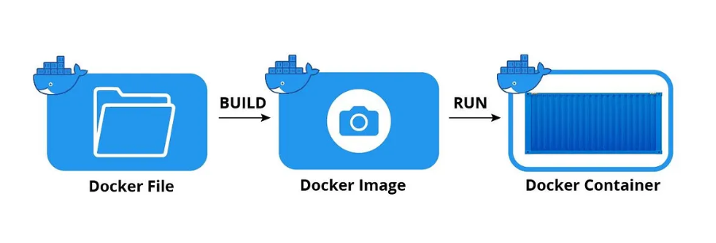

# What is Docker Image
A Docker Image is a lightweight, standalone and executable software package that includes everything needed to run an application: the code, environment variables, configuration files, libraries everything are packed here and this is placed on to the docker.

 * The docker image includes the following to run a piece of software.
 * Docker images are specific to both the operating system (OS) and the CPU architecture for which they were built.

Here we will have adocker file whenever we want to create a docker file which means basically some instructions will be written out and then we can save that file. Then we wull have certain command from docker and that command will be creating image for us from docker file.



## Components of a Docker Image
A Docker image isn't one large, monolithic file. It's cleverly constructed from a series of layers and stored in a registry.

### 1. Layers:
       Layers can be added to base image using code it will enable it to run in a container and an image is composed of a stack of read-only layers. Each instruction in a Dockerfile (like FROM, COPY, RUN) creates a new layer on top of the previous one on to the base image.
     **Efficiency:** When you change an instruction in your Dockerfile, Docker only rebuilds that specific layer and the ones that follow it. This makes builds incredibly fast.
     **Sharing:** If multiple images share the same base layers (e.g., they all start with FROM ubuntu:22.04), those layers are only stored once on your system.

### 2. Base Image
       This is the foundational layer of your image, specified by the FROM command in a Dockerfile. It can be a minimal operating system like alpine, a programming language runtime like python:3.9-slim, or an application like nginx.

### 3. Docker Registries
    A Docker Registry is a storage and distribution system for Docker images. It's a library where you can pull official images, find images shared by the community, and push your own.

    **Docker Hub:** The default public registry and the largest library of container images.
    **Private Registries:** Companies often use private registries (like Amazon ECR, Google Artifact Registry, or Docker Hub private repos) to store their proprietary application images securely.

**Commands Related to Docker Image Operations**

The following are the some of the commands that are used for Docker Images:

| **Command**                  | **Description**                                                                 |
| ---------------------------- | ------------------------------------------------------------------------------  |
| **docker image build**       | This command is used for building an image from the Dockerfile                  |
| **docker image history**     | It is used for knowing the history of the docker image                          |
| **docker image inspect**     | It is used for displaying the detailed information on one or more images        |
| **docker image prune**       | It used for removing unused images that are not associated with any containers  |
| **docker image save**        | This command helps in saving the docker images into a tar archived files        |
| **docker image tag**         | It helps in crating a tag to the target image that refers to the source image   |

### 1. Docker Image Prune

    Docker image prune is a command used in the docker host to remove the images that are not used or Docker image prune command is used to remove the unused docker images.

#### Docker Image Prune
     All the unused images are also know as dangling images which re not associated with any containers

### 2. Docker Image Build
The Following is the command which is used to build the docker image.

**docker build -t your_image_name:tag -f path/to/Dockerfile**

**docker build**: *Initiates the build process.*

**-t your_image_name:tag**  *Gives the image you're creating a name and, if desired, a tag.*

**path/to/Dockerfile** . : Gives the location of the Dockerfile. *Give the right path if it's not in the current directory. "(.) DOT" represents the current workdir.*

### 3. Docker Image Tag

Docker tags are labels for container images, used to differentiate versions and variants of an image during development and deployment. Docker tags will help you identify the various versions of docker images and help distinguish between them. Docker image will help us to build continuous deployment very quickly

### Docker Image Vs Docker Container

The following are the difference between Docker Image and Docker Container:

| **Docker image**                                                                | **Docker container **                                                           |
| ------------------------------------------------------------                    | ------------------------------------------------------------------------------  |
| The Docker image is the Docker container's source code.                         | The Docker container is the running instance of the Docker image. |
| Dockerfile is a prerequisite to Docker Image.                                   | Docker Image is a pre-requisite to Docker Container.                          |
| Docker images can be shared between users with the help of the Docker Registry. | Docker containers can't be shared between the users.    |
| To make changes in the docker image we need to make changes in Dockerfile.      | We can directly interact with the container and can make the changes required.  |


### Docker Image commands
The following are the some of the Docker Image Commands that are widely used:

#### 1. List Docker Images

```docker images```

#### Example

```
$ docker ls

REPOSITORY          TAG                 IMAGE ID            CREATED             SIZE
nginx               latest              0d9c6c5575f5        4 days ago          126MB
ubuntu              18.04               47b199b0cb85        2 weeks ago         64.2MB
```

#### Pull an Docker Image From a Registry

``` docker image pull <image-name> ```

#### Example

```
$ docker pull alpine:3.11

3.11: Pulling from library/alpine
Digest: sha256:9fanfkjn8q9893rhahf98uw893u8ansfkklasf90uuw30r930hjl
Status: Downloaded newer image for alpine:3.11
```

### Docker Images Prune
The Docker Image Prune will remove the unused Docker Images that are not associated with any containers. The Command looks as follows:

```docker image prune```

### Docker Images Filter
When we want to filter some specific images we can filter out them using its labels or its meta information tags with the option **--filter**. The command looks as follows:

```docker image ls -f "reference=mypython-app"```

### Remove an Image from Docker
The following command is used for removing the docker image from the local registry:

```docker rmi <id-of-image>```

#### Example

```$ docker rmi <image_id>```

```
Untagged: <image_id>
Deleted: sha256:<image_id>
```

#### Searching for a specific image on Docker Hub

```docker search ubuntu```

#### Example

```$ docker search ubuntu```

```
NAME                                 DESCRIPTION                                     STARS OFFICIAL                AUTOMATED

ubuntu                      Ubuntu is a Debian-based Linux operating s...                 4458                        [OK]               

ubuntu-upstart              Upstart is an event-based replacement for ...                  62                         [OK]

tutum/ubuntu                 Simple Ubuntu docker images with ssh access                   49                         [OK]               

